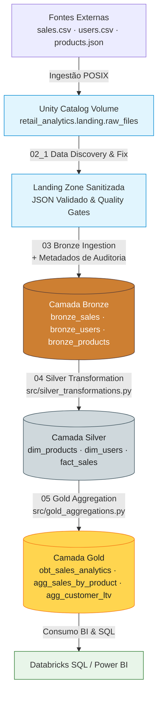

# Retail Analytics Lakehouse — PySpark, Delta Lake & Unity Catalog

Pipeline de Engenharia de Dados ponta a ponta construído no **Databricks** utilizando **PySpark**, **Delta Lake** e **Unity Catalog**, estruturado sob a **Arquitetura Medalhão (Landing, Bronze, Silver e Gold)** e desenhado sob princípios de código modular e configuração orientada a metadados (*metadata-driven*).

---

## Arquitetura do Projeto



### Decisões de Engenharia & Boas Práticas
**Governança com Unity Catalog Volumes:** Os arquivos brutos (CSV e JSON) são ingeridos diretamente em um Volume gerenciado (/Volumes/retail_analytics/landing/raw_files), eliminando dependências legadas de DBFS ou caminhos locais fixos.

**Data Discovery & Sanitização Estrutural (02_1):** Antes da carga na Bronze, o pipeline inspeciona os arquivos brutos e corrige automaticamente anomalias estruturais (como objetos JSON soltos sem colchetes delimitadores []), aplicando Quality Gates (assert) para barrar chaves nulas ou duplicadas.

**Arquitetura Modular (src/ vs notebooks/):** As regras de negócio, expressões regulares ($), tipagem forte (DecimalType, IntegerType, DateType) e integridade referencial (left_semi join) estão desacopladas em módulos Python testáveis na pasta src/, deixando os notebooks enxutos como orquestradores visuais.

**Configuração Metadata-Driven (config/settings.yaml):** Nomes de catálogos, schemas, volumes e tabelas são centralizados em YAML, evitando hardcoding e facilitando a promoção entre ambientes.

**Linhagem e Auditoria:** Todas as tabelas carregam colunas técnicas de rastreabilidade (_ingestion_timestamp, _source_file, _bronze_ingested_at, _silver_processed_at, _gold_processed_at).


## Estrutura do Repositório

```Plaintext

pyspark-retail-analytics/
├── config/
│   └── settings.yaml                  # Metadados de catálogo, schemas, volumes e tabelas
├── notebooks/
│   ├── 01_create_catalog_schema.ipynb # Provisionamento do Catálogo, Schemas e Volume no UC
│   ├── 02_0_generate_mock_data.ipynb  # Download dos dados brutos para a Landing Zone
│   ├── 02_1_data_exploring_and_fixing.ipynb # Diagnóstico, correção do JSON e Quality Gates
│   ├── 03_bronze_ingestion.ipynb      # Ingestão Delta com metadados de auditoria
│   ├── 04_silver_transformation.ipynb # Orquestração da limpeza, tipagem e modelagem Silver
│   └── 05_gold_aggregation.ipynb      # Orquestração da OBT e KPIs de negócio na Gold
├── src/
│   ├── __init__.py                    # Inicialização do pacote Python
│   ├── utils.py                       # Carregamento centralizado de configurações (YAML)
│   ├── silver_transformations.py      # Regras puras de limpeza, regex e integridade referencial
│   ├── gold_aggregations.py         # Construção da OBT e métricas de Produto e LTV
│   └── main.py                        # Orquestrador Python para execução via Workflows/CLI
├── .gitignore                         # Arquivos e diretórios ignorados pelo Git
├── requirements.txt                   # Dependências Python do projeto
└── README.md                          # Documentação principal


```


## Modelo de Dados por Camada

| Camada | Objeto / Tabela | Descrição |
| :--- | :--- | :--- |
| **Landing** | `raw_files` (Volume) | Arquivos originais (`sales.csv`, `users.csv`, `products.json`) após sanitização estrutural. |
| **Bronze** | `bronze_sales`, `bronze_users`, `bronze_products` | Dados brutos persistidos em formato Delta Lake com timestamp de ingestão e arquivo de origem. |
| **Silver** | `dim_products` | Catálogo deduplicado de produtos com preços higienizados via Regex para `Decimal(10,2)` |
| **Silver** | `dim_users` | Cadastro padronizado de clientes (campos sensíveis como senhas removidos na camada). |
| **Silver** | `fact_sales` | Fato de vendas validada por integridade referencial com cálculo de `total_amount`. |
| **Gold** | `obt_sales_analytics` | *One Big Table* desnormalizada unindo vendas, clientes e produtos para análise self-service.|
| **Gold** | `agg_sales_by_product` | Ranking de produtos por receita total, pedidos distintos, unidades vendidas e preço médio. |
| **Gold** | `agg_customer_ltv` | Indicadores de *Lifetime Value* (LTV), frequência de pedidos e ticket médio por cliente. |


## Como Executar
Clonar o repositório no Databricks Repos (ou ambiente local com PySpark configurado).

Revisar config/settings.yaml caso deseje alterar o nome do catálogo (retail_analytics).

Executar os notebooks em sequência (01 → 02_0 → 02_1 → 03 → 04 → 05) em um cluster Databricks com suporte a Unity Catalog.

(Opcional) Para reprocessar apenas as camadas analíticas Silver e Gold via script Python:

### Bash
python -m src.main

Autor **Eduardo de Castro Bello** Data & Analytics Engineer

LinkedIn https://www.linkedin.com/in/eduardo-bello
